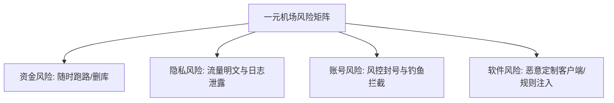

在各大贴吧、论坛及社交平台上，“1元/月”或“12元/年”的**一元机场**（廉价网络节点服务）吸引了大量追求极致性价比的新手用户。

表面上看，只需要付出一杯奶茶零头的价格，就能获得上百G甚至无限流量的节点服务，似乎“香爆了”。然而在实际使用中，绝大多数买过一元机场的用户很快就会遇到**网页打不开、视频频繁卡顿、节点全部超时、甚至登录账号被封**的窘境。

本文将从**底层成本逻辑、实际使用痛点、四大致命风险点**三个维度，深度拆解“一元机场”为什么不可用，以及它背后隐藏的安全陷阱。

---

## 一、 成本悖论：一元机场的真实运营逻辑

要理解一元机场为什么难用，首先需要明白网络节点服务的**硬性成本结构**。

合格的网络接入服务商（包含优质 BGP 接入与 IEPL/IPLC 内网专线）需要支付以下几项固定开支：
1. **入口与出口带宽费用**：高品质专线带宽按 Gbps 计费，价格极其昂贵；
2. **中转服务器与节点维护**：需要配置高性能中转机与高防节点；
3. **原生 IP / 住宅 IP 租用费**：用于解锁流媒体与 AI 工具。

> [!IMPORTANT]
> **商业逻辑悖论：** 一位用户每月仅支付 1 元，扣除支付接口手续费（约 3%-5%）后，商家到手不足 0.95 元。如果提供高质量带宽，商家每服务一位用户就会产生亏损。

为了在 1 元的价格下维持运营并盈利，一元机场只能采取以下手段：
* **极致超卖**：将原本只能容纳 50 人的带宽流量，强行分配给 5,000 甚至上万人使用；
* **使用廉价公网直连（月抛 VPS）**：完全放弃专线与优化中转，使用毫无质量保障的低价公网线路；
* **零维护与零售后**：节点挂掉不及时修复，没有工单支持，降本增效做到极致。

---

## 二、 体验崩溃：为什么一元机场“完全不可用”？

正是由于上述成本缩减手段，一元机场在日常使用中展现出极低的可用性：

### 1. 晚高峰期瘫痪（20:00 - 23:00）
在晚间上网高峰期，公网直连线路会遭遇严重的国际出口拥堵与丢包。加上超卖数千人的用户同时抢夺微薄的带宽，实际测速往往跌至几 kbps，连最基础的网页搜索都无法加载，视频更是无从谈起。

### 2. 节点大量掉线与“红字 Timeout”
廉价公网 VPS 没有防封锁能力，IP 极其容易被防火长城（GFW）阻断。用户经常会发现客户端里的订阅节点在一夜之间全部变成红色超时（Timeout），无法连接。

### 3. IP 纯净度极差，封禁重灾区
由于一元机场的 IP 被海量匿名用户共享使用，其中不乏自动化脚本与垃圾流量，导致其 IP 段普遍被各大平台列入黑名单：
* **Google 搜索**：频繁弹出复杂的 CAPTCHA 人机验证码；
* **AI 平台（ChatGPT / Claude）**：直接拦截并提示 `Access Denied` 或 `403 Forbidden`；
* **流媒体**：完全无法解锁 Netflix、Disney+ 或 HBO 等区域版权限制。

---

## 三、 深扒陷阱：一元机场四大致命风险点

如果说“速度慢、不稳定”只是影响使用体验，那么一元机场背后隐藏的安全风险，则可能对用户的财产与账号安全造成不可逆的损害。

> [!CAUTION]
> **风险一：随时“跑路”与资金回笼收割**
> 许多一元机场的运营周期仅有数周到数月。部分不良商家先以“一元/月”、“10元永久”为噱头吸引大量用户购买长期套餐，当资金池积累到一定程度后，便会瞬间关闭网站、清空 Telegram 群组跑路。虽然单人损失金额不大，但维权成本极高。

> [!WARNING]
> **风险二：隐私泄露与中间人抓包（MITM）**
> 廉价服务商为了降低配置成本，往往不会采用无日志（No-Logs）策略。部分恶意节点甚至搭建了自定义根证书或 HTTP 明文抓包环境，记录用户的访问历史、DNS 查询记录，甚至在HTTP流量中插入广告或恶意代码。

> [!WARNING]
> **风险三：账号异风控与钓鱼安全**
> 一元机场的节点 IP 变动频繁，且往往几十个人同时在同一秒用同一个 IP 登录不同的社交或电商账号。这种异常行为极易触发平台安全风控，导致你的 **Steam、PayPal、Google 账号甚至社交平台被永久冻结**。更严重者，部分“钓鱼机场”专门用来截获未加密的凭证信息。

> [!NOTE]
> **风险四：定制客户端与订阅规则污染**
> 部分一元机场要求用户必须下载其提供的“专用客户端”（非开源通用软件）。这类客户端可能被植入了木马或后门程序。此外，其订阅配置文件中可能包含恶意路由规则，将特定流量强制分流至广告主或钓鱼站点。

---

## 四、 理性建议与正确避坑指南

面对一元机场的诱惑，我们应该如何理性对待网络节点服务？

### 1. 一元机场的唯一合理定位：紧急临时备用
一元机场并非完全没有用处。如果你主用的优质节点突然故障，手里有一个一元机场作为**临时应急备用（仅仅用于打开官网更新主力订阅）**是可行的。但**绝不要将其作为日常主力**。

### 2. 挑选稳定网络服务的 3 大金律
1. **坚持“按月订阅（月付）”**：无论服务商宣传得多么诱人，绝不购买半年、一年或所谓的“永久”套餐，防范跑路风险；
2. **认准通用开源客户端**：仅使用 Clash Verge Rev, Sing-box, Shadowrocket, Surge, Surfboard 等公认安全的开源/正规客户端，绝不安装来源不明的“专用集成端”；
3. **看重线路质量而非节点数量**：优质的 3-5 条 IEPL/IPLC 专线，体验远胜于上百条拥堵的公网直连节点。

---

## 总结

网络服务遵循严格的“一分钱一分货”规律。一元机场背后的带宽成本决定了它只能是一个“高度超卖、极不稳定、存在安全隐患”的临时产物。

为了你的**个人隐私、账号安全以及顺畅的上网体验**，请保持理性消费，远离低价陷阱。
